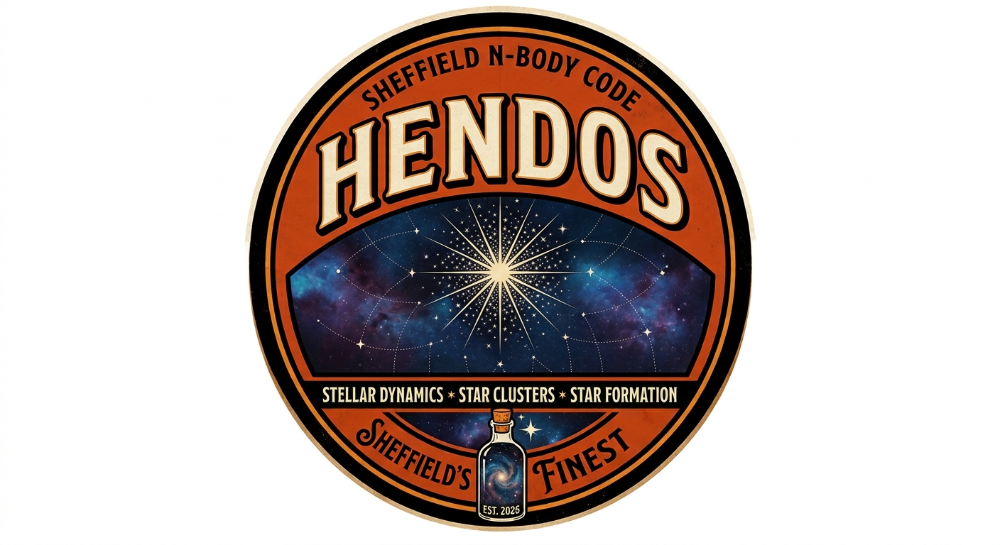

<p align="center"></p>

# HENDOS - HErmite N-body Dynamics Of Systems

The Sheffield group's N-body code for stellar dynamics (named after
Henderson's Relish). This file is the overview; the other READMEs are

- `src/README.md` - what every routine does and which file it is in
- `src/ics/ICS_README.md` - how to change the way initial conditions are made
- `src/ics/FRACTAL_README.md` - how the fractal generator works
- `run/PARAMS_README.md` - a full description of every parameter
- `analysis/README.md` - the viewer and the analysis tools
- `tests/README.md` - the regression tests
- `benchmark/README.md` - comparing HENDOS with Starlab's kira

**These READMEs are kept up to date with the code: any change to the code
that alters what they describe must update them in the same change.**

## Directory structure
```
HENDOS/
  README.md              this file
  src/                   all source code
    README.md            what each routine does and where it is
    nbvars.f90 ...       the N-body code, one module per file
    ics/                 the initial conditions generator
      makeics.f90        the program
      plummersubs.f90    Plummer sphere (routine makeplummer)
      fractalsubs.f90    box fractals (routines makefractal, larsonfractal)
      masssubs.f90       stellar masses (routine maschberger)
      usersubs.f90       YOUR OWN structure, masses and last changes
      icrandom.f90       random numbers (ran3, gasdev)
      ICS_README.md      how to change the generator
      FRACTAL_README.md  how the fractals are made
  run/                   where the code is built and run
    Makefile             builds the executables into this directory
    params.nml           parameter file for hermite
    ics.nml              parameter file for makeics
    PARAMS_README.md     description of every parameter
    build/               object and module files (made by make)
    data/                initial conditions, snapshots, analysis files
  analysis/              looking at a run (Python)
    README.md            how to use them
    hendosview.py        the viewer: 3D view, plots, images, movies
    hendosanalysis.py    analyses of snapshots - add your own
    hendosio.py          reads snapshots and run-time analysis files
    maketestdata.py      test files for trying the viewer
  benchmark/             comparing with other codes (Python)
    README.md            how to run the comparison and read it
    bench_kira.py        runs HENDOS and Starlab's kira on the same stars
    starlabio.py         converts to and from Starlab's dyn format
  tests/                 regression tests (Python)
    README.md            what the tests are and how to add one
    run_tests.py         runs hermite on problems with known answers
  HENDOS_logo.jpg        the HENDOS logo
  docs/                  notes on the methods (LaTeX)
    larson.tex, .pdf     how the Larson fractals match the size-linewidth relation
    tidal.tex, .pdf      the Galactic tidal field and how it is integrated
```

## Building and running (all from `HENDOS/run`)
```
cd HENDOS/run
make                                        (builds hermite and makeics here)
./makeics ics.nml                           (initial conditions: writes data/plum1k.dat)
export OMP_NUM_THREADS=8
./hermite params.nml | tee data/test01.log  (params.nml is the default name)
```
All run parameters are in `params.nml` (Fortran namelist, commented). Sections
changed per run are at the top (`&run`, `&output`, `&analysis`, `&tides`,
`&tree`), standard settings below (`&binaries`, `&collisions`, `&integrator`,
`&computing`). Any parameter or section left out takes its standard value.
Keep one parameter file per run in `run/` (e.g. `params_run01.nml`).

## Looking at a run
`python ../analysis/hendosview.py data` (from `run/`) opens the viewer on the
runs in `data/`: a rotatable 3D view of each snapshot with the stars coloured
by mass, type, speed, energy or timestep; plots against time of quantities
worked out from the snapshots; plots of the run-time analysis files; and
images and movies. It needs Python with numpy and matplotlib. The modules
behind it can be used in your own scripts, and a new analysis is one function
in `analysis/hendosanalysis.py`. See `analysis/README.md`.

## Benchmarking
`benchmark/bench_kira.py` runs the same initial conditions through HENDOS and
Starlab's `kira` at several accuracy settings, measures wall-clock time and
energy error in the same way for both, and plots time against error so the
codes are compared at equal accuracy. See `benchmark/README.md`. No benchmark
has been run yet.

## Data directory
Snapshots and analysis files are written to the directory `datadir` in the
`&output` section. The default, `'data'`, is `HENDOS/run/data`. Any other path
can be given, relative to `run/` or in full (`'/scratch/me/run01'`,
`'~/nbody/run01'`); it is made if it does not exist, and the run stops at the
start if it cannot be written to. The initial conditions file `icfile` is given
with its own path (e.g. `'data/plum1k.dat'`).

## Initial conditions
One program, `makeics`, in `src/ics/`, built into `run/` and driven by the
parameter file `ics.nml` (described in `run/PARAMS_README.md`). In order it
1. makes the **structure** - a Plummer sphere or a box fractal - in model
   units with every mass set to unity;
2. gives each star a **mass** from the Maschberger (2013) IMF (or all equal);
3. scales the positions to the **radius** asked for: the half-mass radius of
   a Plummer sphere, the total radius of a fractal;
4. moves to the centre of mass;
5. scales the **velocities** so that the system, with the masses and size it
   now has, has exactly the virial ratio asked for;
6. calls `userfinal` for any changes of your own;
7. prints a summary and writes the file.

The one exception to step 5 is a **Larson fractal** (`velocities = 'larson'`):
its velocities are set to the observed size-linewidth relation in km/s
(coefficient `vlarson`), the virial ratio asked for is not used, and the
virial ratio that results is reported. It rises as radius squared over mass.

All stars are single and of type `star`; binaries and multiples are not made
yet. All random numbers come from `ran3`.

The generator is written to be changed. `src/ics/usersubs.f90` holds three
routines for your own code - your own structure (`distribution = 'user'`),
your own masses (`imf = 'user'`) and a last step that can alter anything -
and every place in `makeics.f90` you are likely to want to change is marked
`! >>> CHANGE HERE`. `src/ics/ICS_README.md` gives recipes.

Fractal velocity fields: `standard` (the original makefractal velocities),
`inherit`, `random` and `larson`. In tests of a Python copy of the routines
(N = 1000, fractal dimension 1.6, ten fractals each) the rms velocity
difference between stars rose with separation to the power 0.50 for `larson`,
0.8 for `inherit`, 0.1 for `standard` and 0.0 for `random`. See
`src/ics/FRACTAL_README.md`, and `docs/larson.tex` for the Larson velocities.

## Units
- Internally: G = 1, mass unit = 1 Msun, length unit = 1 pc
  (velocity unit 0.06558 km/s, time unit 14.91 Myr - never shown to the user).
- ALL input and output is physical: Msun, pc, km/s, Myr (timesteps in yr).

## Particle types
- Every particle has a type: `star` (default), `white_dwarf`, `neutron_star`,
  `black_hole`, `planet`. In files the type is this name (no spaces, any case).
- Internally an integer code `itype(i)` indexing the table `typename` in
  `nbvars.f90` (named codes `tstar`, `twdwarf`, `tnstar`, `tbhole`, `tplanet`).
- To add a type: increase `ntypes` and add the name to `typename` in
  `nbvars.f90` (max 12 characters, padded with blanks). Nothing else changes.
- Types are set by the initial-conditions generator, read by `readic` (unknown
  names stop the run with the list of known types), kept through binary
  closing/opening (`btype`), and written to every snapshot.
- Types are labels only at present: they do not change the dynamics.

## Files (Linux: no spaces anywhere; `runid` may only use letters, digits, - _ .)
- `<datadir>/<runid>_snap_<time>Myr.dat` snapshots, time zero padded so `ls`
  lists them in time order, e.g. `data/test01_snap_000012.2500Myr.dat`
- `<datadir>/<runid>_ana_<name>.dat` in-run analysis
- `<datadir>/<runid>_mergers.dat` one line per stellar merger (made at the
  first merger)
- `<datadir>/<runid>_restart.bin` restart file, binary (if `trestart` > 0)
- A new run (start time 0) refuses to start if files for its runid exist in
  the data directory.
- The `creator` header line of every file is `HENDOS (<source file>)`.

## Snapshot format (NBODY-SNAPSHOT 2) - also the initial-conditions format
- Header of `# key = value` lines (format, creator, date, runid, parameter file,
  initial conditions, time_Myr, n, total mass, units, frame, particle_types
  (number of each type), tide, integrator settings, energies and energy error,
  Lagrangian radii, c.o.m., wall time, columns and their units), ending
  `# end_header`.
- Then one line per star, in id order: `id m x y z vx vy vz type phi dt`
  (type = particle type name, phi = gravitational + tidal potential per unit
  mass, dt = current timestep).
- All N stars always appear individually (binaries and few-body groups are
  invisible in output). After a merger there is one star fewer.
- **The header is meant to grow.** The rules that keep old and new files
  readable by the same programs: readers look keys up by name and ignore keys
  they do not know; a key that is missing means that physics was off; the key
  `physics` lists what was on (e.g. `gravity tide binaries few_body mergers`);
  and columns are found by name from the `columns` key, with new columns added
  after the existing ones. The lines that depend on the physics are written by
  `hdrphysics` in `src/nbout.f90`, one block per piece of physics, each written
  only when it is switched on - so a run without a tide has no tidal keys, and
  stellar evolution will add its own block when it is on. `hendosio.py` reads
  files this way already.
- Initial-condition generators write the same format (first 9 columns); the code
  reads the first 9 columns and the start time from `time_Myr`, so any snapshot
  restarts a run.
- Older files still work, with every particle a star: NBODY-SNAPSHOT 1 (same
  but no type column) and legacy files with lines `m x y z vx vy vz`
  (bigfractals). The version is the number after NBODY-SNAPSHOT in the header.
- The first 8 columns are numeric; column 9 is text, so e.g. in Python use
  `np.loadtxt(f, usecols=range(8))` for the numbers and
  `np.loadtxt(f, usecols=8, dtype=str)` for the types.

## Screen output (`screen` in `&output`)
- `standard`: short header (including the number of each particle type and the
  data directory), one line per `tout` (time, % done, dE/E, Q, r_h, wall time,
  time left), summary at the end.
- `verbose`: also parameters, initial-condition diagnostics, and a block per
  output (energy components, errors, Lagrangian radii, c.o.m. drift, steps,
  timestep-level histogram, binaries, tree, speed).
- Warnings in both modes: |dE/E| > `dewarn`, steps held at `kmax`.
- Energies (direct-N, expensive) are only computed for screen output and snapshots.

## In-run analysis (`&analysis`)
Each analysis has a switch, runs every `tana`, writes `<runid>_ana_<name>.dat`
with a metadata header. Example included: `lagrangian` (1-90% Lagrangian radii,
sigma_3D). How to add a new one is described at the top of `src/nbana.f90`.

## Integrator
- 4th-order Hermite (Makino & Aarseth 1992), block timesteps in powers of two on
  an exact integer clock, all stars synchronised every `tout`.
- dt = min(Aarseth criterion, `etap` x shortest pairwise free-fall/flyby time).
- Predictor uses each star's a2, a3 from its last step (keeps 4th order with the
  velocity-dependent Coriolis force of the tide).
- Smallest step `tout/2**kmax`; steps limited there are reported.

## Physics options
- **Galactic tide** (`&tides`): Hill's approximation in the rotating frame,
  'none', 'solar' (Oort A, B: Bovy 2017; rho0: McKee et al. 2015) or a user tensor.
  Energies are Jacobi energies. Full description: `docs/tidal.tex`.
- **Binaries** (`&binaries`, no regularisation): an unperturbed bound pair
  (gamma = 2 r_apo^3 sum m_k/d_k^3 / m_b < `gclose`) is replaced by one body with
  an exact Kepler orbit; opened again when gamma > `gopen`. Binaries in the
  initial conditions are closed at the start. Candidates: stars with steps <
  `dtclose`. Requires eps = 0.
- **Few-body encounters** (`fewbody` in `&binaries`; after the `multiples`
  module of AMUSE): a close group of 3 to 6 stars - a binary meeting a star or
  another binary, or a perturbed pair and its perturber - whose perturbation by
  the rest of the cluster is below `gfew` is replaced by one centre-of-mass body
  and integrated on its own by a small shared-timestep Hermite integrator
  (`src/nbfew.f90`). The group and the cluster advance together in time. It is
  opened again when gamma > 10 `gfew`, which is what happens when a star is
  ejected. A group of three that passes the Mardling & Aarseth (2001) stability
  test is frozen as two nested Kepler orbits (no secular evolution, so no
  Kozai-Lidov cycles).
- **Stellar collisions and mergers** (`&collisions`): two stars that pass
  within `rcoll` (default 10 Rsun) have collided - checked from the
  closest-approach distance in the force loop plus the two-body pericentre, and
  inside few-body groups. With `mergers` on (the default) they are merged: total
  mass at the centre of mass, id of the more massive, type of the more compact,
  no mass loss. Each merger is announced on the screen (`** MERGER`), written to
  `<runid>_mergers.dat` and counted in the snapshot headers; the orbital energy
  removed is tracked so the energy check still works. With `mergers` off the run
  stops with an alert. The same `rcoll` is used for every particle type.
- **Neighbour scheme** (`&neighbours`): Ahmad-Cohen scheme for direct
  summation in its Hermite form. Each star has a neighbour list; the neighbour
  (irregular) force is summed every step and the rest (regular force) only on
  longer regular steps, being extrapolated linearly in between and corrected by
  a Hermite corrector over the regular step. Not used with the tree, and
  switched off (with a note on the screen) for fewer than 150 stars.
- **Restart files** (`trestart`, `restart`): the complete state in binary,
  written at output times, from which a run carries on exactly. The file is a
  list of named sections that a reader can skip, so new physics can add its own.
- **Barnes-Hut tree** (`&tree`): octree with monopole, quadrupole and octupole
  moments, opening angle `theta`; jerk from monopole + internal-motion quadrupole
  term. The tree is rebuilt every `ntreebuild` block steps (standard value 10)
  and restocked (moments recomputed) on every step in between. Tide works with the tree; energies stay direct.

## Parallelisation (OpenMP)
Every loop whose cost grows with N is parallel; the number of threads is set
with `OMP_NUM_THREADS` and printed at the start of a run.
- **Forces**: parallel over active stars for big blocks (>= `nompmin`) or over
  the j-sum with reductions for small blocks (N >= `nompj`); tree walks
  parallel over active stars.
- **Each block**: block-time search, the list of active particles, predictor,
  corrector, acceptance and new timestep levels.
- **Tree build**: shared out at the top level - the root's eight octants are
  built by separate threads, each looking through all the particles for those
  in its octant. 2, 4 or 8 threads share the octants evenly and no more than 8
  are used. The tree is identical to a serial build.
- **Tree moments**: parallel over the leaves, then over the top-level subtrees
  for the internal nodes.
- **Neighbour scheme**: big blocks share out the active stars; for small
  blocks each full sum and neighbour search is shared out; the list
  bookkeeping when bodies change is parallel.
- **Other**: starting timesteps, energies and potentials, and the O(N) sums in
  the binary routines (perturbation, nearest neighbour).

Still serial, because they are cheap or rare: the binary and collision
bookkeeping between blocks, the few-body integrator (a handful of stars),
output and the in-run analysis.

## Testing
`tests/run_tests.py` runs `hermite` on 15 small problems with known answers
(two-body orbits, the Pythagorean problem, a frozen triple, a Plummer sphere
by direct sums, neighbour scheme, tree and with a tide, a merger, restarts,
header flexibility) and checks each against a tolerance. Run it after every
change. See `tests/README.md`.

## Status
Developed without a Fortran compiler: **none of the Fortran has been compiled
or run.** The algorithms were checked with Python models before or while the
Fortran was written (Hermite + block steps, tide, binaries, tree and its
parallel build, the neighbour scheme, the few-body integrator), and the
Fortran was checked for block structure. Not covered by any Python model, and
so the most likely places for mistakes: the bookkeeping that forms and opens
few-body groups, the neighbour-list updates when bodies change, mergers inside
the main code, and the restart file. The first compilation will need fixes;
the regression tests are there to find the rest, and their tolerances are
first guesses.

Known limits of the new parts:
- few-body groups are integrated without the cluster's tidal pull on them
  (that is what `gfew` bounds), and with a shared, not time-symmetric step, so
  a group that lives for very many orbits without freezing or opening slowly
  drifts in energy (about 3e-9 of its binding energy per orbit at
  `etafew` = 0.02);
- only triples are frozen; stable quadruples (2+2, 3+1) stay integrated;
- frozen triples have no secular evolution;
- mergers conserve mass and momentum, with no mass loss, kick or change of
  radius - stellar evolution will supply those;
- in the neighbour scheme the predictor's higher-order terms are not corrected
  when a neighbour list changes (NBODY6 does this), and every block still
  predicts all N bodies.
